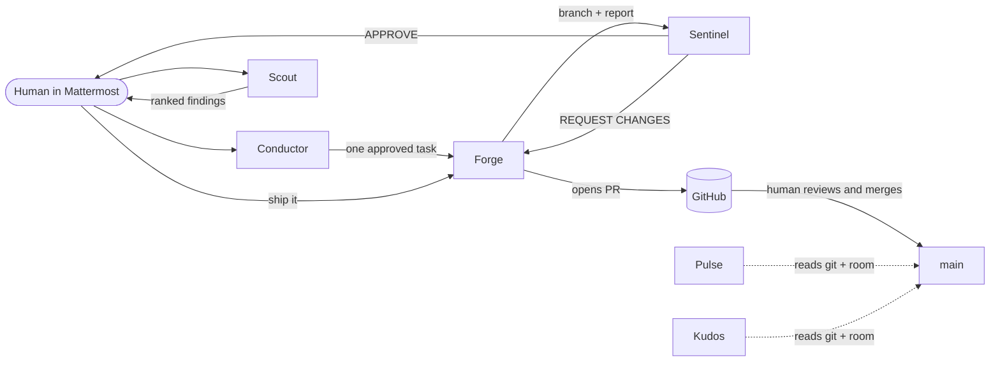

# DevCrew

**An AI development team that lives in your team chat.**

DevCrew is six AI agents working inside a shared Mattermost channel through [Switch](https://docs.switchagents.ai), alongside the developers. Each agent has one job and a hard boundary. One agent builds, a different agent independently verifies, and a human decides what ships.

Built by **Team Dynamo** for the Flip the Switch hackathon (Track 1: Best Business Workflow).

- Demo video: <DEMO_VIDEO_LINK>
- Blog post: <BLOG_LINK>

## The problem

AI coding assistants usually work alone. One agent writes the code, tells you the tests pass, and you take its word for it. Teams also lose track of who asked for what, what was reviewed, and what actually shipped.

DevCrew puts the whole loop in the channel where the team already talks, so everyone sees every request, review and decision.

## Meet the crew

| Agent         | Role            | What it does                                                                                                       | Cannot do                      |
| ------------- | --------------- | ------------------------------------------------------------------------------------------------------------------ | ------------------------------ |
| **Conductor** | Orchestrator    | Turns a goal into a plan, asks for approval, hands each step to one specialist                                     | Touch code or the repo         |
| **Scout**     | Project Analyst | Runs tests and typecheck, reads the code, reports ranked findings                                                  | Edit files, commit, push       |
| **Forge**     | Builder         | Fixes bugs and builds features on a `forge/*` branch with tests, pushes it, opens a PR on "ship it"                | Push to main, merge, review    |
| **Sentinel**  | Code Reviewer   | Re-runs everything itself, probes the change with real requests, checks the diff against a rubric, posts a verdict | Edit files, commit, push       |
| **Pulse**     | Team Reporter   | Standups from git history and room activity                                                                        | Investigate or change anything |
| **Kudos**     | Appreciation    | Evidence-based "Contribution Moments" for people and agents, only for what is new since its last post              | Rank or score anyone           |

Each agent's full instructions live in [`agents/`](agents/) and in [`devcrew-template.yaml`](devcrew-template.yaml).

## How it works



1. **Scout finds.** `@scout analyze the project` returns a ranked list of findings with evidence.
2. **Conductor routes.** After the human approves specific findings, Conductor sends them to Forge as a self-contained task.
3. **Forge builds.** It syncs main, branches, writes a failing test first for bugs, fixes, runs typecheck and tests, pushes the branch, and posts a fixed-format report ending in "Ready for @sentinel to review."
4. **Sentinel verifies.** That mention starts Sentinel by itself. It never trusts Forge's report: it runs the tests on the branch and on the base, checks mergeability and commit messages, tries to break the new behavior, and posts `APPROVE`, `APPROVE WITH NITS` or `REQUEST CHANGES`.
5. **Fix loop.** On `REQUEST CHANGES`, Forge fixes and Sentinel re-reviews. The loop is capped at 2 rounds, then a human decides.
6. **A human ships.** Saying "ship it" makes Forge check that Sentinel approved that exact commit. Only then does it open a pull request. Forge never merges.
7. **Report and recognize.** `@pulse` summarizes what happened. `@kudos` credits real contributions.

### Design rules that keep it trustworthy

- **The builder never grades its own work.** Sentinel is a separate agent with its own clone and instructions.
- **Roles are enforced in each agent's own instructions.** A request outside an agent's role gets a short redirect to the right agent, not an answer.
- **Redirects never use `@`.** In Switch, any `@mention` starts that agent's session, so only real handoffs mention an agent.
- **Humans approve consequential actions.** Conductor asks before sending findings to Forge, and nothing ships without "ship it".
- **Evidence over claims.** Agents report only numbers they produced, and say "not verified" otherwise.

## How we use Switch

- **Agents connected:** six [OpenCode](https://opencode.ai) agents, each registered as its own Switch agent with its own working directory, instructions and role.
- **Platform:** Mattermost, using the local server bundled with Switch Console.
- **Room:** one channel, `DevCrew`, with all six agents added. People and agents work in the same thread of conversation.
- **Handoffs:** agent-to-agent `@mentions` start sessions automatically. This is what lets Forge hand to Sentinel with no human in between. It only works with each agent's "Who can talk to your agent" setting on **Anyone**.
- **One-file setup:** [`devcrew-template.yaml`](devcrew-template.yaml) creates the room and all agents.

## Run it yourself

### Prerequisites

- [Switch Console](https://docs.switchagents.ai) installed, with the local server running
- Docker Desktop, running (Switch uses it for the bundled Mattermost)
- [OpenCode](https://opencode.ai) installed and logged in with a model. On Windows, install it on Windows itself. Switch did not detect an OpenCode installed inside WSL.
- Node.js 20 or newer
- [GitHub CLI](https://cli.github.com) signed in (`gh auth login`). Forge opens PRs through `gh` and stops if it is not authenticated.
- A GitHub account with push access to your copy of this repo

### Steps

1. **Fork or clone this repo** and note your repo URL.
2. **Set the repo URL.** In `devcrew-template.yaml`, replace `https://github.com/DOOMSDAY101/tasklet.git` with your repo URL (it appears once per agent that clones).
3. **Connect OpenCode.** In Console, go to Settings, then Agent providers, then OpenCode. Wait until the Switch connector reads _installed_.
4. **Import the template.** In Console, create a room from `devcrew-template.yaml`. Accept the default folders or choose your own. Each agent gets its own empty folder, which it fills with its own clone on first run.
5. **Link your Mattermost account** to your Switch user, once, so agents recognize you.
6. **Check each agent's settings:** auto-create a session on notify is on, and "Who can talk to your agent" is **Anyone**.
7. **Say hello** in the `DevCrew` channel:
   ```
   @scout analyze the project and tell me the most valuable improvements.
   ```
   The first reply from each agent is slow while it clones the repo and installs dependencies. That is expected.

### Try the full loop

```
@scout analyze the project and tell me the most valuable improvements.
@conductor send findings 1 and 2 to whoever can fix them.      (approve when asked)
```

Then watch Forge report and Sentinel review on its own. When Sentinel approves:

```
@forge ship it
@pulse i need an update
@kudos celebrate the team
```

## Repository layout

```
.
├── AGENTS.md                  Project facts every agent reads (stack, commands, conventions)
├── agents/                    Source of truth for each agent's instructions
│   ├── README.md              Roster, triggers and permissions
│   ├── conductor.md  forge.md  scout.md  sentinel.md  pulse.md  kudos.md
├── .agents/skills/            Skills loaded by Forge and Sentinel
├── devcrew-template.yaml      Switch template: room plus all six agents
└── apps/                      Tasklet, the demo project the crew works on
    ├── api/                   Express + TypeScript API (node:test, supertest)
    └── web/                   Next.js 14 + TypeScript frontend
```

### The demo project: Tasklet

Tasklet is a small task-list app (Express API and Next.js frontend, npm workspaces). It exists so the crew has real code to work on. It started with two seeded bugs, an empty task title accepted on `POST /tasks` and `204` returned for deleting a missing task, which the crew found, fixed, reviewed and shipped.

To use DevCrew on your own project, change the repo URL in the template and keep an `AGENTS.md` at the repo root with an `Install`, `Typecheck`, `Test` and `Build` command table. Use `none` for a command your project does not have.

```bash
npm install
npm run typecheck
npm test
npm run dev:api    # port 4000
npm run dev:web    # port 3000
```

## What we learned

- **Agents need to be told what not to do.** Our builder happily answered status questions until we gave it an explicit role boundary.
- **A mention is a trigger.** An `@` inside an instruction ("then hand off to @sentinel") woke an agent we never meant to start. Every mention in a multi-agent room should be deliberate.
- **Agents follow the letter of the rules.** Forge followed every rule and still left its work uncommitted, because we never said to commit.
- **A three-level rubric made the reviewer honest.** With only "ok" and "issue", real concerns slid into notes. Adding "nit" fixed it.
- **A placeholder in a prompt can be routed around.** Sentinel cloned the repo correctly even with a broken URL in its instructions.

## Known limitations

- Cold-start sessions take a few minutes before the first reply.
- We saw intermittent `EPROTO: TLS handshake failed` turn failures that went away on retry.
- Role boundaries are enforced by instructions, not by hard permissions, so a determined prompt could talk an agent past them.
- Pulse and Kudos can only use room history if Switch exposes it to the session.

## Team

**Team Dynamo**: Sulaiman Ifeoluwa and Nwanze Justin

## License

**MIT** [`LICENSE`](LICENSE)
